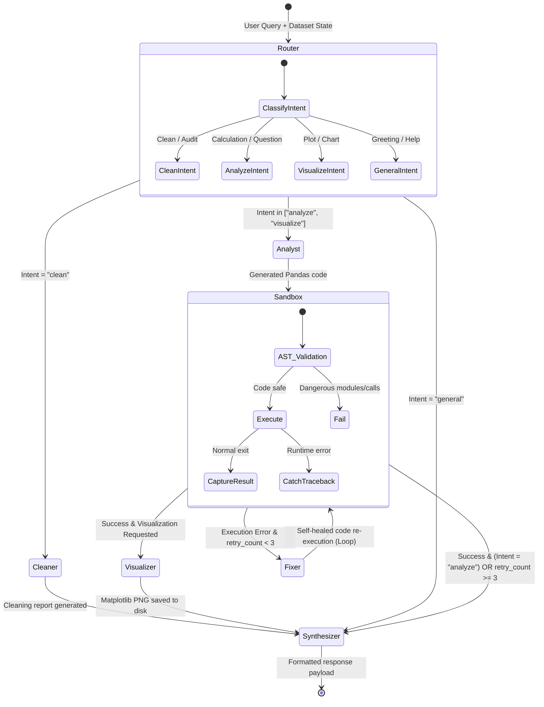

# 🧠 Multi-Agent Data Analysis Workspace

An enterprise-ready, autonomous **Multi-Agent Data Analysis Workspace** that combines **FastAPI**, **LangChain & LangGraph**, **Pandas**, **Matplotlib**, and a modern **Next.js** frontend into a unified reactive environment.

Users can upload CSV datasets and ask an autonomous multi-agent team to clean, query, analyze, and visualize data through safe Python execution sandboxing.

---

## 🏗️ Architecture & Workflow

```
[ User Browser ]
       │
       ▼ (Port 3000)
[ Next.js Frontend ] ─── Axios / REST ───► [ FastAPI Backend ] (Port 8000)
                                                 │
                             ┌───────────────────┴───────────────────┐
                             │  LangGraph Multi-Agent State Machine  │
                             └───────────────────┬───────────────────┘
                                                 │
          ┌───────────────────────┬──────────────┴──────────────┬────────────────────────┐
          ▼                       ▼                             ▼                        ▼
  Agent 1: The Cleaner    Agent 2: The Analyst         Execution Sandbox       Agent 3: The Visualizer
  • Pandas missing audit  • Query to Python code        • AST Safety Guard      • Matplotlib synthesis
  • Outlier IQR anomalies • Dataframe aggregations      • In-memory execution   • High-res PNG export
  • Health score 0-100    • Self-Healing Fixer (Loop)   • Stdout & return val   • Image URL serving
```

---

## 🛠️ Tech Stack

* **Frontend:** Next.js (App Router, React 19, TypeScript, Tailwind CSS, Lucide Icons)
* **Backend:** FastAPI (Async ASGI, Pydantic Settings, Python 3.12)
* **AI Orchestration:** LangChain Core, LangChain OpenAI, LangGraph StateGraph
* **Data Processing & Analysis:** Pandas, NumPy
* **Visualization:** Matplotlib, Seaborn
* **Database & Cache:** PostgreSQL (pgvector) & Redis
* **Containerization:** Docker & Docker Compose

---

## 🚀 Quick Start with Docker

### 1. Prerequisites
* [Docker Desktop](https://www.docker.com/products/docker-desktop/) installed and running.

### 2. Configure Environment
Copy the example environment configuration:
```bash
cp .env.example .env
```
*(Optional)* Configure your LLM provider in `.env` (supports **ChatHuggingFace** and **OpenAI**):
```env
# Hugging Face (Default)
LLM_PROVIDER=huggingface
HUGGINGFACEHUB_API_TOKEN=hf_...
HUGGINGFACE_REPO_ID=meta-llama/Meta-Llama-3-8B-Instruct

# OpenAI (Alternative)
# LLM_PROVIDER=openai
# OPENAI_API_KEY=sk-...
# OPENAI_MODEL_NAME=gpt-4o-mini
```
> **Note:** If no API key is provided, the workspace automatically activates its **smart offline fallback engine**, enabling full local testing and analysis execution without external API dependencies.

### 3. Launching Environments with Docker Compose

#### A. Development Environment (Hot-Reloading for FastAPI & Next.js)
```bash
docker compose -f docker-compose.dev.yml up --build
```
* **FastAPI Backend:** Mounts `./Server/app` with `--reload` active.
* **Next.js Frontend:** Mounts `./client/src` with Turbopack & HMR (`WATCHPACK_POLLING=true`).
* **Isolated Volumes:** Prevents host OS node_modules mismatch.

#### B. Production Environment (Optimized, Immutable Containers)
```bash
docker compose -f docker-compose.prod.yml up --build -d
```
* Multi-worker ASGI backend (`--workers 4`).
* Optimized Next.js production build (`next start`).
* Self-contained images with restart policies enabled.

#### C. Automated Test Suite Runner (Inside Docker Network)
```bash
docker compose -f docker-compose.prod.yml --profile test run --rm tester
```

### 4. Access the Workspace
* **Frontend UI:** [http://localhost:3000](http://localhost:3000)
* **FastAPI Interactive Swagger Docs:** [http://localhost:8000/docs](http://localhost:8000/docs)
* **FastAPI OpenAPI JSON:** [http://localhost:8000/api/v1/openapi.json](http://localhost:8000/api/v1/openapi.json)

---

## 💻 Local Development Setup (Without Docker)

### Backend (FastAPI)
```bash
cd Server
# Create virtual environment
python -m venv .venv
source .venv/bin/activate  # On Windows: .\.venv\Scripts\activate

# Install dependencies
pip install -r requirements.txt

# Start FastAPI development server
uvicorn app.main:app --host 0.0.0.0 --port 8000 --reload
```

### Frontend (Next.js)
```bash
cd client
# Install dependencies
npm install

# Start Next.js development server
npm run dev
```

---

## 🔄 LangGraph State Machine & Node Transitions

The core intelligence is driven by a compiled `StateGraph(AnalysisState)`:



### LangGraph Nodes
1. **`router`**: Inspects user query keywords and metadata to classify intent (`clean`, `analyze`, `visualize`, `general`).
2. **`cleaner`** *(Agent 1)*: Runs Pandas audit to identify missing values, duplicate rows, and statistical IQR outliers ($Q_1 - 1.5\text{IQR}$, $Q_3 + 1.5\text{IQR}$). Calculates dataset health score (0–100%).
3. **`analyst`** *(Agent 2)*: Generates Python code targeting `df` to compute answer.
4. **`sandbox`**: Inspects code with Python AST against blacklisted calls (`os`, `sys`, `subprocess`, `eval`, `exec`). Executes inside isolated namespace and captures stdout / return values.
5. **`fixer`**: If execution fails with an error or exception, analyzes the traceback and refactors code up to 3 retry attempts.
6. **`visualizer`** *(Agent 3)*: Generates Matplotlib chart script, renders figure to `/app/uploads/charts/<chart_uuid>.png`, closes memory figure, and returns chart URL.
7. **`synthesizer`**: Compiles final Markdown summary, code inspection blocks, chart links, and timeline steps.

---

## 🛡️ Code Execution Sandboxing & Guardrails

The workspace executes dynamic Python code using a defense-in-depth approach:
* **Abstract Syntax Tree (AST) Validation**:
  * Blocks prohibited modules: `os`, `sys`, `subprocess`, `shutil`, `socket`, `http`, `urllib`, `requests`, `pty`, `ctypes`, `multiprocessing`.
  * Blocks dangerous built-in functions: `eval()`, `exec()`, `compile()`, `__import__()`, `open()`, `input()`.
* **Execution Scope Containment**:
  * DataFrame is passed as an isolated copy (`df.copy()`).
  * `__builtins__` is restricted to safe utility functions (`len`, `range`, `min`, `max`, `sum`, `sorted`, `str`, `int`, `float`, `dict`, `list`).
* **Memory & Resource Management**:
  * Matplotlib figures are configured with headless `Agg` backend and immediately closed with `plt.close('all')` after exporting to disk to avoid server memory leaks.

---

## 📡 API Documentation

### 1. Ingest Dataset
* **Endpoint:** `POST /api/v1/analysis/upload`
* **Content-Type:** `multipart/form-data`
* **Parameters:**
  * `csv` *(File, required)*: The CSV dataset file.
  * `analysis_id` *(string, optional)*: Custom or existing session ID.
* **Response (201 Created):**
```json
{
  "analysis_id": "90e6cf98-8ea8-4cf5-b108-96349ce8bf08",
  "dataset_id": "90e6cf98-8ea8-4cf5-b108-96349ce8bf08",
  "filename": "sales_q3.csv",
  "total_rows": 1500,
  "total_columns": 8,
  "health_score": 94,
  "cleaning_report": {
    "total_rows": 1500,
    "total_columns": 8,
    "duplicate_rows": 0,
    "total_missing_cells": 12,
    "health_score": 94,
    "anomalies": [],
    "recommendations": ["Impute missing values in 'revenue' (12 nulls, 0.8%)."]
  },
  "sample_preview": [ ... ],
  "columns": [
    { "name": "date", "dtype": "object", "missing_count": 0 },
    { "name": "revenue", "dtype": "float64", "missing_count": 12 }
  ],
  "msg": "Dataset successfully uploaded, scanned, and ready for analysis."
}
```

---

### 2. Multi-Agent Query
* **Endpoint:** `POST /api/v1/analysis/query`
* **Content-Type:** `application/json`
* **Body:**
```json
{
  "analysis_id": "90e6cf98-8ea8-4cf5-b108-96349ce8bf08",
  "query": "Show me the monthly sales trend for Q3 and create a chart"
}
```
* **Response (200 OK):**
```json
{
  "analysis_id": "90e6cf98-8ea8-4cf5-b108-96349ce8bf08",
  "user_query": "Show me the monthly sales trend for Q3 and create a chart",
  "intent": "visualize",
  "summary": "### 📈 Analysis Results\n\nMonthly Trend Analysis:\n...",
  "code": "grouped = df.groupby('month')['revenue'].sum()\nresult = grouped.reset_index()",
  "result_text": "...",
  "chart_urls": ["/api/v1/analysis/charts/chart_a1b2c3d4e5f6.png"],
  "agent_steps": [
    { "agent": "Analyst", "status": "completed", "summary": "Generated Python pandas code..." },
    { "agent": "Sandbox", "status": "completed", "summary": "Executed Python analysis successfully." },
    { "agent": "Visualizer", "status": "completed", "summary": "Generated Matplotlib visualization: chart_a1b2c3d4e5f6.png" }
  ],
  "timestamp": "2026-10-05T20:45:00.000Z"
}
```

---

### 3. List Ingested Datasets
* **Endpoint:** `GET /api/v1/analysis/datasets`
* **Response (200 OK):**
```json
[
  {
    "analysis_id": "customer_churn_q3",
    "filename": "customer_churn_q3.csv",
    "total_rows": 14280,
    "total_columns": 11,
    "health_score": 94,
    "created_at": "2026-10-07T01:43:00.000Z"
  }
]
```

---

### 4. Data Preview
* **Endpoint:** `GET /api/v1/analysis/{analysis_id}/preview?limit=50`
* **Response (200 OK):**
```json
{
  "columns": [ { "name": "product", "dtype": "object" }, { "name": "sales", "dtype": "int64" } ],
  "rows": [ { "product": "Widget A", "sales": 100 } ],
  "total_rows": 1500,
  "total_columns": 2
}
```

---

### 5. Fetch Chart Image
* **Endpoint:** `GET /api/v1/analysis/charts/{filename}`
* **Response:** Direct binary stream of the Matplotlib `.png` image.

---

### 6. Delete Analysis Chat Session
* **Endpoint:** `DELETE /api/v1/analysis/{analysis_id}`
* **Response (200 OK):**
```json
{
  "status": "success",
  "analysis_id": "90e6cf98-8ea8-4cf5-b108-96349ce8bf08",
  "message": "Analysis chat '90e6cf98-8ea8-4cf5-b108-96349ce8bf08' and its single CSV dataset were successfully deleted."
}
```

---

## 🔒 1:1 Analysis Chat Constraint (Strict Single CSV per Chat)
* **One Dataset Rule**: Each Analysis (Chat) session is strictly bound to **one single CSV file**.
* **Upload Rejection**: Attempting to upload a second CSV file into an existing `analysis_id` returns `HTTP 400 Bad Request` (`"Each analysis chat is strictly limited to one CSV file."`).
* **Multi-file Rejection**: Submitting multiple files simultaneously in the upload endpoint or drag-and-drop zone is blocked and rejected.
* **New Chats**: To analyze a different dataset, users start a new chat via `+ New Analytics Chat` (`POST /api/v1/analysis/upload`).

---

## 🧪 Testing

To run the automated backend test suite:
```bash
cd Server
.\.venv\Scripts\python.exe -c "
import tests.test_cleaner as tc
tc.test_cleaner_detects_missing_values_and_anomalies()
tc.test_cleaner_handles_clean_dataset()
print('PASS: Cleaner Tests')

import tests.test_sandbox as ts
ts.test_sandbox_executes_safe_code()
ts.test_sandbox_blocks_dangerous_imports()
ts.test_sandbox_blocks_eval_and_exec()
ts.test_sandbox_captures_runtime_exceptions()
print('PASS: Sandbox Tests')

import tests.test_graph as tg
tg.test_full_langgraph_pipeline_execution()
print('PASS: Full LangGraph Pipeline Tests')

import tests.test_single_csv_constraint as tsc
tsc.test_single_csv_per_analysis_chat()
print('PASS: Single CSV Constraint Tests')

print('ALL TESTS PASSED SUCCESSFULLY')
"
```

Frontend type-check & build:
```bash
cd client
npx tsc --noEmit
npm run build
```

---

## 📄 License
MIT License &copy; 2026 Multi-Agent Data Analysis Workspace Team.
