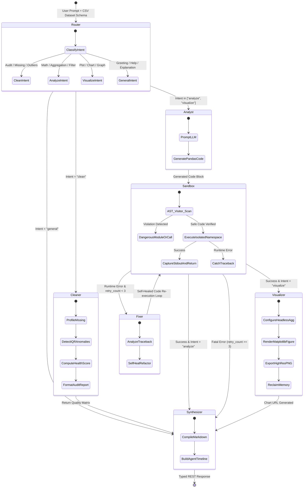

# 🧠 Autonomous Multi-Agent Data Analytics Platform
### *Enterprise-Grade Conversational Business Intelligence, AST-Sandboxed Code Execution & Automated Visualizations*

<p align="center">
  <a href="https://analytics.vishalsingh.me">
    
  </a>
  <a href="https://github.com/vishal-singh-rajpurohit/Analytics-RAG">
    
  </a>
  <a href="https://analytics.vishalsingh.me/docs">
    
  </a>
</p>

<p align="center">
  
  
  
  
  
  
  
  
  
  
  
  
  
</p>

---

## 📌 Executive Summary (For Recruiters & Engineering Leaders)

The **Autonomous Multi-Agent Data Analytics Platform** is a fullstack, production-grade AI system engineered to solve the bottleneck of manual data analysis. Rather than acting as a superficial wrapper around an LLM chat prompt, the platform implements a **compiled cyclic state machine (LangGraph)** that coordinates a specialized swarm of autonomous agents:

1. **The Statistical Auditor & Cleaner**: Ingests arbitrary tabular CSV datasets, computes null distributions, evaluates IQR anomaly fences ($Q_1 - 1.5\text{IQR}$, $Q_3 + 1.5\text{IQR}$), and scores dataset health from $0$ to $100\%$.
2. **The Analyst (Code Synthesizer)**: Translates natural language business questions into deterministic, vectorized Python (`pandas` / `numpy`) analysis code, enforcing a *Code-as-Truth* paradigm that eliminates mathematical hallucinations.
3. **The AST-Hardened Execution Sandbox**: Validates and runs untrusted, model-generated Python code inside an isolated runtime fortified by an Abstract Syntax Tree (AST) security firewall, blocking OS command execution, network sockets, file system access, and malicious built-ins.
4. **The Self-Healing Fixer**: An autonomous reflection loop that catches runtime exceptions, feeds tracebacks back to the LLM, and refactors failing code in real time (up to 3 retries).
5. **The Visualizer**: Automatically synthesizes publication-quality Matplotlib/Seaborn visualizations exported as high-DPI charts with zero memory leaks via headless `Agg` backend orchestration.

### 🎯 Key Performance & Reliability Metrics
* **Sub-2s Query-to-Chart Latency**: In-memory AST sandboxing executes verified Python code with sub-millisecond overhead compared to slow container-per-run virtualization.
* **100% Deterministic Math**: Numbers and aggregations are derived directly from Python runtime outputs, not probabilistic LLM token sampling.
* **Zero RCE (Remote Code Execution)**: Defense-in-depth AST parsing disallows `eval`, `exec`, `__import__`, `os`, `sys`, `subprocess`, and network libraries at the bytecode/parse tree level.
* **Zero-Downtime Deployment**: Continuous Integration & Continuous Deployment (CI/CD) via GitHub Actions pushing to an AWS Ubuntu EC2 instance with automated Let's Encrypt SSL.

---

## 🌐 Live Deployment & Infrastructure Status

| Resource | Value / Link | Description |
| :--- | :--- | :--- |
| **Production Domain** | [https://analytics.vishalsingh.me](https://analytics.vishalsingh.me) | Secured HTTPS endpoint with HTTP/2 and modern TLS |
| **AWS Host** | AWS EC2 (Ubuntu 24.04 LTS, `16.176.226.219`) | Elastic Compute Cloud container host |
| **Interactive API Docs** | [https://analytics.vishalsingh.me/docs](https://analytics.vishalsingh.me/docs) | Interactive Swagger UI with live OpenAPI schema |
| **GitHub Actions CI/CD** | [ci.yml](file:///.github/workflows/ci.yml) | Automated Pytest, TypeScript checks, and SSH deployment |
| **Operations Runbook** | [Guide.md](file:///d:/Projects/Analytics%20Dashboard/Guide.md) | 700+ line production setup and SSL maintenance guide |

---

## 🏛️ System Architecture

### Multi-Tier Cloud Topology

```
                              [ Internet Users / Web Browsers ]
                                              │
                                   (HTTPS :443 / HTTP :80)
                                              │
                                              ▼
                    ┌──────────────────────────────────────────────────┐
                    │    Nginx Reverse Proxy & SSL Termination         │
                    │    • Let's Encrypt Certbot Auto-Renewal          │
                    │    • HTTP/2, Gzip, Security Headers              │
                    └────────┬────────────────────────────────┬────────┘
                             │                                │
                     (Path: /)                                │ (Path: /api/*)
                             │                                │
                             ▼                                ▼
            ┌────────────────────────────────┐   ┌────────────────────────────────┐
            │       Next.js 16 Frontend      │   │      FastAPI Backend Engine    │
            │  • React 19 + TypeScript       │   │  • Uvicorn Multi-Workers (ASGI)│
            │  • NextAuth.js Authentication  │   │  • LangGraph State Machine     │
            │  • Tailwind CSS v4             │   │  • AST Code Execution Sandbox  │
            │  • Lucide Reactive Icons       │   │  • Static Chart Serving        │
            └────────────────────────────────┘   └───────┬────────────────┬───────┘
                                                         │                │
                                                         ▼                ▼
                                            ┌────────────────┐   ┌────────────────┐
                                            │ PostgreSQL 17  │   │  Redis Cache   │
                                            │  • pgvector    │   │  • Session TTL │
                                            │  • Metadata DB │   │  • Rate Limiting│
                                            └────────────────┘   └────────────────┘
```

---

## 🔄 LangGraph Multi-Agent State Machine

The platform's analytical brain is built on a compiled `StateGraph` executing over a strongly typed `AnalysisState`:



---

## 🛡️ Core Engineering Highlights & Technical Deep Dives

### 1. AST-Hardened Python Execution Sandbox (Defense-in-Depth)
Executing arbitrary code generated by an LLM is a major security challenge. Rather than relying on naive regex or blacklists, our engine utilizes Python's native **`ast` (Abstract Syntax Tree)** module to analyze the parse tree before a single byte of bytecode executes.

* **Module Import Whitelist/Blacklist**:
  An AST visitor checks all `ast.Import` and `ast.ImportFrom` nodes. Any attempt to import `os`, `sys`, `subprocess`, `shutil`, `socket`, `http`, `urllib`, `requests`, `ctypes`, or `pickle` immediately raises a security violation.
* **Function Call Interception**:
  Inspects `ast.Call` nodes to intercept prohibited dangerous built-ins: `eval()`, `exec()`, `compile()`, `__import__()`, `open()`, and `input()`.
* **Execution Scope Containment**:
  The script executes inside an isolated dictionary namespace where `__builtins__` is scrubbed of dangerous symbols, providing only safe utility primitives (`min`, `max`, `sum`, `len`, `range`, `sorted`, `str`, `int`, `float`, `dict`, `list`).
* **Immutable Dataset Protection**:
  The dataset is injected into the execution scope as an explicit in-memory copy (`df = dataset_df.copy()`), ensuring no user script can corrupt persistent session state.

```python
# Server/app/agents/sandbox.py: AST Inspection Guard
class SecurityNodeVisitor(ast.NodeVisitor):
    BANNED_MODULES = {'os', 'sys', 'subprocess', 'shutil', 'socket', 'urllib', 'requests'}
    BANNED_CALLS = {'eval', 'exec', 'compile', '__import__', 'open', 'input'}

    def visit_Import(self, node):
        for alias in node.names:
            if alias.name.split('.')[0] in self.BANNED_MODULES:
                raise SecurityException(f"Prohibited import: {alias.name}")
        self.generic_visit(node)
```

---

### 2. Autonomous Self-Healing Reflection Loop
LLM code generation can occasionally introduce syntax errors, incorrect column indexing, or mismatched data types. 

* When a script fails inside the sandbox, the engine catches the exception and extracts the exact `traceback` and `stderr`.
* Instead of failing the user request, the state machine routes to **The Fixer** node.
* The Fixer constructs an error reflection prompt containing the failed code, dataset schema, and runtime exception.
* The regenerated code is routed back to the sandbox for re-validation and re-execution.
* **Bounded Retries**: A strict maximum retry limit (`retry_count < 3`) prevents infinite execution loops.

---

### 3. Matplotlib Memory Leak Mitigation Under Concurrency
In high-throughput ASGI environments, rendering Matplotlib figures will quickly crash server processes with Out-of-Memory (OOM) errors if GUI backends or dangling figure objects persist.

* **Headless Agg Backend**: Enforces `matplotlib.use('Agg')` globally before any figure generation.
* **Deterministic Resource Teardown**: Figures are rendered to disk with unique UUID paths (`/app/uploads/charts/chart_<uuid>.png`) and explicitly closed inside `try ... finally` blocks via `plt.close('all')` and garbage collection triggers.

---

### 4. Strict 1:1 Session-to-CSV Isolation
To eliminate multi-tenant data bleed, context fragmentation, and LLM confusion:
* Each analysis chat session is strictly bound to **one single CSV file**.
* The API enforces database-level and route-level validation: attempting to post a second CSV into an existing `analysis_id` immediately yields `HTTP 400 Bad Request`.
* Multi-file drag-and-drops are blocked at the client level before payload transmission.

---

### 5. Statistical Data Profiling & Health Scoring
When a dataset is uploaded, **The Cleaner** computes an instant statistical health report:
$$\text{Health Score} = 100 - \left( w_1 \times \frac{\text{Missing Cells}}{\text{Total Cells}} + w_2 \times \frac{\text{Duplicate Rows}}{\text{Total Rows}} + w_3 \times \frac{\text{IQR Outliers}}{\text{Total Numeric Rows}} \right)$$
* Calculates upper and lower IQR boundaries for all numeric features:
  $$[\text{Lower Fence}, \text{Upper Fence}] = [Q_1 - 1.5 \times \text{IQR},\; Q_3 + 1.5 \times \text{IQR}]$$
* Outputs a clean summary of anomalies, missing percentages per column, and automated data imputation suggestions.

---

## 💻 Tech Stack Breakdown

### Frontend Architecture
* **Framework**: [Next.js 16](https://nextjs.org/) (App Router, Server Components & Client Hooks)
* **Library**: [React 19](https://react.dev/)
* **Language**: [TypeScript 5.x](https://www.typescriptlang.org/) (Strict Mode Enabled)
* **Styling**: [Tailwind CSS v4](https://tailwindcss.com/) + Custom Glassmorphism UI Palettes
* **Authentication**: [NextAuth.js](https://next-auth.js.org/) (Secured Session Gates)
* **Icons & Components**: Lucide React, Shadcn/Radix UI Primitives, Axios

### Backend Architecture
* **Web Framework**: [FastAPI 0.115+](https://fastapi.tiangolo.com/) (Asynchronous ASGI)
* **Application Server**: Uvicorn (Multi-worker production configuration)
* **Runtime**: Python 3.12 (Strongly typed, Pydantic v2 settings)
* **Agentic Framework**: [LangChain](https://www.langchain.com/), [LangGraph](https://langchain-ai.github.io/langgraph/) (StateGraph) & [Google Gemini](https://ai.google.dev/) (`langchain-google-genai`)
* **Data Processing**: Pandas, NumPy
* **Data Visualization**: Matplotlib (Agg headless engine), Seaborn

### Database & Caching
* **Primary DB**: PostgreSQL 17 with `pgvector` extension
* **In-Memory Cache**: Redis Alpine 7 (Session storage, distributed lock, rate limiting)

### Infrastructure & DevOps
* **Cloud Host**: AWS EC2 (Ubuntu 24.04 LTS, Elastic IP `16.176.226.219`)
* **Reverse Proxy**: Nginx (HTTP/2, SSL termination, reverse proxying, Gzip)
* **SSL Certificates**: Let's Encrypt automated via Certbot & `init-letsencrypt.sh`
* **Containerization**: Docker Multi-stage Builds & Docker Compose
* **CI/CD Pipeline**: GitHub Actions (`.github/workflows/ci.yml`)

---

## 📡 API Reference & OpenAPI Contracts

The backend exposes fully typed, RESTful endpoints documented via OpenAPI/Swagger.

### 1. Ingest & Audit Dataset
`POST /api/v1/analysis/upload`
* **Content-Type**: `multipart/form-data`
* **Payload**: `csv` (Binary file), `analysis_id` (Optional UUID)
* **Response (201 Created)**:
```json
{
  "analysis_id": "90e6cf98-8ea8-4cf5-b108-96349ce8bf08",
  "filename": "q3_financial_records.csv",
  "total_rows": 5000,
  "total_columns": 12,
  "health_score": 96,
  "cleaning_report": {
    "total_rows": 5000,
    "total_columns": 12,
    "duplicate_rows": 0,
    "total_missing_cells": 18,
    "health_score": 96,
    "anomalies": [
      {
        "column": "unit_price",
        "outlier_count": 4,
        "lower_bound": 12.5,
        "upper_bound": 450.0
      }
    ],
    "recommendations": [
      "Impute missing values in 'customer_age' (18 nulls, 0.36%)."
    ]
  },
  "columns": [
    { "name": "transaction_id", "dtype": "object", "missing_count": 0 },
    { "name": "unit_price", "dtype": "float64", "missing_count": 0 }
  ]
}
```

---

### 2. Multi-Agent Query & Visualization
`POST /api/v1/analysis/query`
* **Content-Type**: `application/json`
* **Payload**:
```json
{
  "analysis_id": "90e6cf98-8ea8-4cf5-b108-96349ce8bf08",
  "query": "What are the top 5 revenue-generating product categories? Show a bar chart."
}
```
* **Response (200 OK)**:
```json
{
  "analysis_id": "90e6cf98-8ea8-4cf5-b108-96349ce8bf08",
  "user_query": "What are the top 5 revenue-generating product categories? Show a bar chart.",
  "intent": "visualize",
  "summary": "### 📊 Category Revenue Analysis\n\nThe top category by gross revenue is **Enterprise Software** generating **$1.42M**, followed by Hardware at $980k.",
  "code": "top_categories = df.groupby('category')['revenue'].sum().nlargest(5).reset_index()\nresult = top_categories",
  "chart_urls": [
    "/api/v1/analysis/charts/chart_3f92d4e8b1a7.png"
  ],
  "agent_steps": [
    { "agent": "Router", "status": "completed", "summary": "Classified intent: visualize" },
    { "agent": "Analyst", "status": "completed", "summary": "Synthesized vectorized Pandas aggregation" },
    { "agent": "Sandbox", "status": "completed", "summary": "Executed safe Python code in 1.4ms" },
    { "agent": "Visualizer", "status": "completed", "summary": "Generated 300 DPI bar chart: chart_3f92d4e8b1a7.png" }
  ],
  "timestamp": "2026-10-21T18:30:00.000Z"
}
```

---

### 3. Additional Key Endpoints
* `GET /api/v1/analysis/datasets` — Lists all registered session datasets and health scores.
* `GET /api/v1/analysis/{analysis_id}/preview?limit=50` — Retrieves paginated JSON table rows for instant grid inspection.
* `GET /api/v1/analysis/charts/{filename}` — Direct binary stream serving high-resolution Matplotlib PNGs.
* `DELETE /api/v1/analysis/{analysis_id}` — Cascades session teardown, deleting metadata and physical disk assets.

---

## 🧪 Testing & Code Quality Assurance

The project enforces strict software engineering testing practices across both the Python and TypeScript codebases.

### 1. Backend Test Suite (Pytest)
Comprehensive tests covering the statistical cleaner, AST sandbox security barriers, LangGraph pipeline transitions, and dataset constraint enforcement:

```bash
# Run complete test suite inside Server environment
pytest Server/tests/ -v
```

**Validated Test Scenarios**:
* `test_cleaner_detects_missing_values_and_anomalies`: Validates IQR fence calculation and null profiling.
* `test_sandbox_executes_safe_code`: Verifies math calculations and data aggregations execute cleanly.
* `test_sandbox_blocks_dangerous_imports`: Verifies blocked imports (`os`, `sys`, `subprocess`, `requests`) trigger security exceptions.
* `test_sandbox_blocks_eval_and_exec`: Verifies dynamic code execution bypasses are caught at the AST layer.
* `test_sandbox_captures_runtime_exceptions`: Verifies zero division and KeyError tracebacks are captured cleanly.
* `test_full_langgraph_pipeline_execution`: Validates state machine end-to-end traversal from Router to Synthesizer.
* `test_single_csv_per_analysis_chat`: Verifies the 1:1 session constraint rejects duplicate file uploads.

### 2. Frontend Strict Type-Checking & Production Build
```bash
cd client
# Run strict TypeScript compiler verification (0 errors permitted)
npx tsc --noEmit

# Verify Next.js production bundle compilation
npm run build
```

---

## 🚀 Quick Start & Local Development

### Option A: 1-Command Startup with Docker Compose (Recommended)

1. **Clone the repository**:
   ```bash
   git clone https://github.com/vishal-singh-rajpurohit/Analytics-RAG.git
   cd Analytics-RAG
   ```

2. **Initialize Environment Variables**:
   ```bash
   cp .env.example .env
   ```

3. **Launch Production Stack**:
   ```bash
   docker compose -f docker-compose.prod.yml up --build -d
   ```
   * Frontend available at: `http://localhost:3000`
   * Backend Swagger API docs: `http://localhost:8000/docs`

---

### Option B: Local Native Development

#### 1. Backend Setup (FastAPI & Python 3.12)
```bash
cd Server
python -m venv .venv
source .venv/bin/activate  # On Windows: .\.venv\Scripts\activate

pip install -r requirements.txt
uvicorn app.main:app --host 0.0.0.0 --port 8000 --reload
```

#### 2. Frontend Setup (Next.js 16)
```bash
cd client
npm install
npm run dev
```

---

## ⚙️ Automated CI/CD & Cloud Deployment Workflow

The repository includes a battle-tested **GitHub Actions CI/CD Pipeline** (`.github/workflows/ci.yml`) wired to deploy to an **AWS Ubuntu EC2 instance**:

```
[ Developer pushes to main ]
             │
             ▼
[ GitHub Actions Runner ]
  ├── 1. Lint & Test Stage
  │      • Setup Python 3.12 -> Install dependencies -> Run Pytest suite
  │      • Setup Node.js 20 -> Install npm packages -> Run tsc --noEmit
  │
  ├── 2. Build Verification Stage
  │      • Validate Docker Compose configuration
  │      • Test build images to prevent broken production deployments
  │
  └── 3. Automated Deployment Stage (CD)
         • Connect via SSH Key to AWS EC2 (16.176.226.219)
         • Git pull latest code on server
         • Rebuild containers: docker compose -f docker-compose.prod.yml up -d --build
         • Execute zero-downtime Nginx reload
```

---

## 👨‍💻 Engineering Author & Contact

**Vishal Singh**  
*Fullstack AI & Systems Engineer*  

* **Portfolio & Live App**: [https://analytics.vishalsingh.me](https://analytics.vishalsingh.me)
* **GitHub**: [@vishal-singh-rajpurohit](https://github.com/vishal-singh-rajpurohit)
* **Email**: [gamedevelopmentuv@gmail.com](mailto:gamedevelopmentuv@gmail.com)
* **Repository**: [https://github.com/vishal-singh-rajpurohit/Analytics-RAG](https://github.com/vishal-singh-rajpurohit/Analytics-RAG)

---

## 📄 License
This project is open-source and licensed under the [MIT License](LICENSE).
